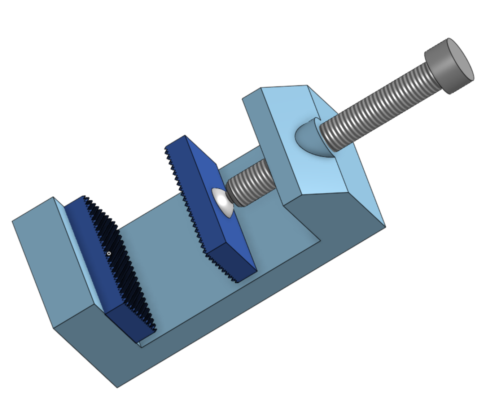
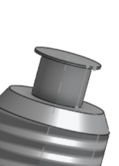

# HackClub_Week-2

Repository for hackclub's week 2

---

> Initially I was created handwriting machine but even after days of efforts, I encounted some problems that just couldn't be solved quickly and as such for the final submission, I had to ditch that and create this.
> The Journay contains the entry to the progress that I had with that project.

---

## Created Table clamp on onShape

A compact 3D CAD assembly of a mechanical bench vise created in Onshape. Designed with a focus on core structural geometry, functional jaw interfaces, and streamlined part relations.

### Components

1. **Base Plate & Stationary Body**
2. **Movable Jaw**
3. **Screw to Tighten**
4. **Serrated Jaw Inserts**

### Working

If you are familiar with clamps,

At first glance it may look like it will not work but the screw end and the caps combination allows it to rotate without effecting the clamp while the screw is screwing:

